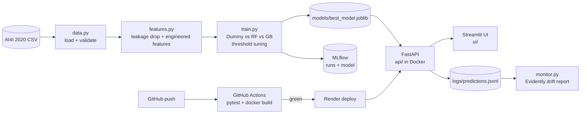

# Predictive Maintenance — Machine Failure Classification

End-to-end, deploy-ready classification project on the **AI4I 2020 Predictive
Maintenance** dataset (UCI). The goal: predict whether an industrial milling
machine is about to **fail**, from live sensor readings, so maintenance can be
scheduled *before* an unplanned breakdown.

> Business framing: an unplanned failure is far more expensive than a scheduled
> check. A model that catches failures early reduces downtime and cost — so we
> optimise for **catching failures (recall)**, not raw accuracy.

**Live demo (UI):** https://full-pipeline-of-gb-ml-2vjjqpqeetori2jemteza7.streamlit.app/  
**Live API:** https://predictive-maintenance-api-wg6l.onrender.com/docs
(Render free tier — the first request after idle takes ~1 min to wake up)

## Highlights

- **Leakage caught and removed** — the five failure-mode flags match the target in 99.7% of rows.
- **Right metric for rare events** — models compared on PR-AUC, not accuracy (3.4% failure rate).
- **Business-driven threshold** — tuned without test leakage to catch ≥85% of failures.
- **Physics-informed features** — all three engineered features land in the top 5 by importance.
- **No train/serve skew** — the API reuses the exact training feature code.
- **Production plumbing** — MLflow tracking, Docker, 15 pytest tests, GitHub Actions CI,
  Evidently drift monitoring, auto-deploy to Render only after CI passes.

## Architecture



| Layer | Tech |
|-------|------|
| Data & modeling | pandas, scikit-learn (Gradient Boosting), SHAP |
| Experiment tracking | MLflow (local SQLite) |
| Serving | FastAPI + Pydantic, Uvicorn, Docker |
| Testing & CI | pytest, GitHub Actions |
| Monitoring | Evidently (KS / chi-square drift tests) |
| Deployment | Render (API, `render.yaml`), Streamlit Community Cloud (UI) |

## Project phases

| Phase | What was done |
|-------|---------------|
| 0 | Repo scaffold, single `config.py` for paths, columns and seeds |
| 1 | Data download + **EDA**: imbalance, failure modes, leakage check, figures |
| 2 | Dummy baseline → Random Forest → **Gradient Boosting**, PR-AUC, threshold tuning |
| 3 | Explainability: permutation importance + SHAP (global and local) |
| 4 | MLflow tracking: nested runs per model, metrics, figures, logged model |
| 5 | FastAPI service: `/health`, `/predict`, `/predict/batch` with Pydantic validation |
| 6 | Docker image (slim, non-root, healthcheck) + pytest suite |
| 7 | CI with GitHub Actions: tests → Docker build → container smoke test |
| 8 | Prediction logging + Evidently drift monitoring |
| 9 | Live deployment: API on Render, Streamlit UI on Streamlit Cloud |

## Structure

```
.
├── config.py        # all paths, column names, settings in ONE place
├── data.py          # download + load + validate
├── eda.py           # exploratory analysis -> prints + saves figures
├── features.py      # feature engineering + preprocessing (one-hot, drops)
├── train.py         # baseline vs RF vs GB, metrics, threshold tuning, MLflow, save
├── explain.py       # SHAP + permutation importance (global + local)
├── monitor.py       # Evidently drift report: training data vs API traffic
├── api/             # FastAPI service
│   ├── schemas.py   # Pydantic request/response validation
│   ├── service.py   # model loading + inference (reuses feature engineering)
│   └── main.py      # FastAPI app + endpoints + prediction logging
├── ui/              # Streamlit front-end (calls the deployed API, no model code)
│   ├── streamlit_app.py
│   └── requirements.txt
├── tests/           # pytest: features, service, API
├── models/          # best_model.joblib (pipeline + tuned threshold)
├── reports/         # metrics_summary.json + figures/
├── data/            # ai4i2020.csv (downloaded, git-ignored)
├── Dockerfile       # serving image (API only)
├── render.yaml      # Render blueprint (deploys after CI passes)
├── .github/workflows/ci.yml
├── requirements.txt       # full dev/training environment
└── requirements-api.txt   # minimal serving deps (used by Docker + CI)
```

## Quickstart

Python 3.10. All commands run from the project root.

```bash
python -m venv venv
venv\Scriptsctivate            # Windows  (Linux/macOS: source venv/bin/activate)
pip install -r requirements.txt
```

**Train the model (optional — a trained model is already committed):**

```bash
python data.py      # download the dataset into data/
python eda.py       # EDA: prints findings + writes reports/figures/01..04
python train.py     # compare models, tune threshold, save model, log to MLflow
python explain.py   # SHAP + permutation importance -> reports/figures/07..10
mlflow ui --backend-store-uri sqlite:///mlflow.db   # browse runs at http://127.0.0.1:5000
```

**Test:**

```bash
python -m pytest -q
```

**Serve the API** (either way, then open http://127.0.0.1:8000/docs):

```bash
uvicorn api.main:app --reload                      # local Python
docker build -t pm-api .                           # or Docker
docker run -d -p 8000:8000 -v ./logs:/app/logs pm-api
```

**Run the UI** against the local API:

```bash
pip install -r ui/requirements.txt
API_URL=http://127.0.0.1:8000 streamlit run ui/streamlit_app.py
# PowerShell: $env:API_URL="http://127.0.0.1:8000"; streamlit run ui/streamlit_app.py
```

**Check for data drift** (after the API has received traffic):

```bash
python monitor.py              # or: python monitor.py --simulate
```

## CI/CD and deployment

1. Every push / PR runs `.github/workflows/ci.yml`: install serving deps → `pytest`
   → `docker build` → start the container and check `/health` reports the model loaded.
2. Render watches `main` via `render.yaml` with `autoDeployTrigger: checksPass`, so
   a commit is deployed **only after CI is green**.
3. The container reads Render's `PORT` env var (defaults to 8000 locally).
4. The Streamlit UI on Streamlit Cloud redeploys from `ui/` on every push.

## Security notes

- No secrets in the repo; the API needs none. Future secrets belong in GitHub
  Secrets / Render environment variables, never in code.
- All inputs are validated (types, ranges, allowed categories); batch requests are
  capped at 1000 readings to prevent memory-exhaustion abuse.
- The container runs as a non-root user; the CI workflow has read-only permissions.
- Runtime data (`data/`, `logs/`, `mlruns/`, `mlflow.db`) is git-ignored.

## Key EDA findings (Phase 1)

- **10,000 rows, 0 missing values, 0 duplicates** — clean data, verified not assumed.
- **Severe class imbalance:** failure rate = **3.39%**. This is *why* we will not
  use accuracy (always predicting "no failure" already scores ~96.6%). We will use
  **PR-AUC, recall and F1** instead.
- **Failure modes:** HDF (115) > OSF (98) > PWF (95) > TWF (46) > RNF (19).
  RNF is random by design (0.1% chance, no sensor signal) — noted for careful handling.
- **Leakage caught:** the five mode flags match the target in **99.7%** of rows —
  they are the answer in disguise, so they are **dropped before modeling**.
- **Signal exists:** failed machines show higher **torque** (50.2 vs 39.6 Nm) and
  higher **tool wear** (144 vs 107 min); torque is the most correlated feature (0.19).
- **Type matters:** low-quality parts fail more (L 3.9% > M 2.8% > H 2.1%), so
  `Type` is a useful categorical feature (one-hot encoded later).

## Model results (Phase 2)

Trained on an 80/20 **stratified** split (preserving the 3.4% failure ratio).
Compared with **PR-AUC** (area under precision-recall curve) — the right metric
for rare-event detection, not accuracy.

| Model | CV PR-AUC (train) | Test PR-AUC | Test ROC-AUC |
|-------|------------------|-------------|--------------|
| Baseline (majority class) | 0.034 | 0.034 | 0.500 |
| Random Forest | 0.891 | 0.872 | 0.978 |
| **Gradient Boosting (best)** | **0.910** | **0.901** | 0.971 |

**Decision threshold tuned for the business goal** (catch ≥85% of failures),
chosen on out-of-fold train probabilities (no test leakage), then evaluated once
on the untouched test set:

| Operating point | Precision | Recall | F1 | Failures missed (FN) | False alarms (FP) |
|-----------------|-----------|--------|----|----------------------|-------------------|
| Default (0.5) | 1.000 | 0.794 | 0.885 | 14 / 68 | 0 |
| **Tuned (0.158)** | 0.841 | **0.853** | 0.847 | **10 / 68** | 11 |

**Business reading:** tuning catches **4 more real failures** (14→10 missed) by
accepting 11 false alarms out of 2,000 machines — the trade-off we want, since a
missed failure (unplanned downtime) costs far more than a precautionary check.

Feature engineering (physics-informed) added: `temp_diff` (heat dissipation),
`power` (torque × angular speed), and `wear × torque` (overstrain) — each mapped
to a real failure mode.

## Explainability (Phase 3)

We explain the model globally and locally, and check whether the engineered
features earned their place.

**Permutation importance** (drop in test PR-AUC when a feature is shuffled):
`Rotational speed` (0.36) > **`temp_diff`** (0.35) > `Process temperature` (0.29)
> **`power`** (0.29) > **`wear_x_torque`** (0.23) > ... All **three engineered
features land in the top 5** — the physics-informed feature engineering clearly paid off.

**SHAP** (mean |SHAP|): `Tool wear` > `Rotational speed` > **`temp_diff`** > `Torque`
> **`power`** > **`wear_x_torque`**. Consistent story: tool wear, speed and the
temperature gap dominate individual predictions.

Figures: `07_permutation_importance`, `08_shap_summary` (beeswarm),
`09_shap_bar`, `10_shap_local_failure` (why one specific machine was flagged).

## API (Phase 5)

The trained model is served over HTTP with **FastAPI**. The API accepts **raw
sensor readings** and applies the *same* feature engineering used in training
(via `features.add_domain_features`), so there is no train/serve skew.

```bash
uvicorn api.main:app --reload
# open http://127.0.0.1:8000/docs  (interactive Swagger UI)
```

| Method | Path | Purpose |
|--------|------|---------|
| GET | `/health` | readiness check (model loaded? which threshold?) |
| POST | `/predict` | score one machine |
| POST | `/predict/batch` | score many machines in one call (max 1000) |

```bash
curl -X POST http://127.0.0.1:8000/predict -H "Content-Type: application/json" \
  -d '{"type":"L","air_temperature":298.9,"process_temperature":309.0,
       "rotational_speed":1300,"torque":65.0,"tool_wear":220}'
# -> {"failure_predicted": true, "failure_probability": 0.9854,
#     "risk_level": "high", "threshold_used": 0.1583, ...}
```

Input is validated by Pydantic: an invalid `type` or out-of-range sensor value
returns HTTP **422** automatically — no bad data reaches the model.

## Monitoring (Phase 8)

Every request to `/predict` and `/predict/batch` is appended to
`logs/predictions.jsonl` (raw inputs + predicted probability). `monitor.py`
compares that live traffic against the **training split** with Evidently and
writes `reports/drift_report.html`.

```bash
python monitor.py              # real API traffic vs training data
python monitor.py --simulate   # demo: shifts the test split (+3 K air, +60 min wear)
```

Drift is judged with **statistical tests** (KS for sensors, chi-square for `Type`,
p < 0.05) rather than Evidently's default distance metrics. Distances ignore sample
size: on a 50-row batch of perfectly normal traffic they flagged 3/6 features as
drifted, whereas the tests correctly flag 0/6. On the simulated shift they flag
exactly the two shifted features (air temperature, tool wear).

With Docker, mount the log folder to keep traffic on the host:
`docker run -d -p 8000:8000 -v ./logs:/app/logs pm-api`

## Dataset

AI4I 2020 Predictive Maintenance Dataset, UCI ML Repository. Synthetic but modeled
on a real milling machine. Please cite: S. Matzka, "Explainable Artificial
Intelligence for Predictive Maintenance Applications," 2020.

## License

Code: [MIT](LICENSE). Dataset: UCI ML Repository, CC BY 4.0.
